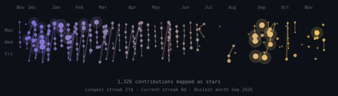

 

  

  

  

  

  

<picture>
  <source media="(prefers-color-scheme: dark)" srcset="https://raw.githubusercontent.com/m3hrab/m3hrab/output/constellation-dark.svg" />
  <source media="(prefers-color-scheme: light)" srcset="https://raw.githubusercontent.com/m3hrab/m3hrab/output/constellation.svg" />
  
</picture>

  

 

